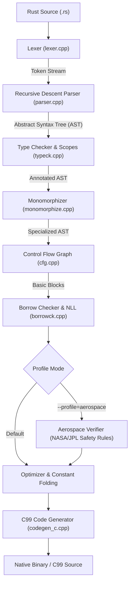

# Oxide

An independent, open-source compiler for the Rust programming language implemented from scratch in C++20.

Oxide provides an alternative implementation of the Rust language frontend, type checker, borrow checker, and code generator. It does not depend on `rustc` or LLVM libraries for its core pipeline, emitting clean C99 for target code generation to maintain portability and eliminate circular bootstrapping dependencies.

---

## Architecture Pipeline



### Compiler Modules

* **Lexer (`include/lexer.hpp`, `src/lexer.cpp`)**: Tokenizes UTF-8 Rust source code, tracking line and column positions. Handles single-line and multi-line comments.
* **Parser (`include/parser.hpp`, `src/parser.cpp`)**: Recursive descent parser that constructs the AST. Implements operator precedence parsing for expressions, functions, `let` bindings, control flow (`if`/`else`), and trailing block return expressions.
* **Type Checker (`include/typeck.hpp`, `src/typeck.cpp`)**: Enforces Rust's static typing rules. Manages lexical scopes, validates function call arity and parameter types, and ensures block evaluations match return types.
* **Monomorphizer (`include/monomorphize.hpp`, `src/monomorphize.cpp`)**: Reifies generic functions and compound structs into concrete specialized AST instances.
* **Control Flow Graph (`include/cfg.hpp`, `src/cfg.cpp`)**: Lowers the AST into basic blocks with explicit terminators (`Goto`, `Branch`, `Return`) and tracks variable reads/writes.
* **Borrow Checker (`include/borrowck.hpp`, `src/borrowck.cpp`)**: Enforces core Rust memory safety rules:
  - Computes variable liveness across basic blocks via backward dataflow analysis.
  - Non-Lexical Lifetimes (NLL): loans remain active only while a holder reference variable is live.
  - Reassignment to immutable variables is rejected.
  - Mutable references (`&mut`) to immutable locals are rejected.
  - Simultaneous mutable and immutable aliasing is rejected.
  - Use of uninitialized variables is rejected.
* **Aerospace Verifier (`include/aerospace.hpp`, `src/aerospace.cpp`)**: Enforces safety-critical constraints under `--profile=aerospace`:
  - NASA/JPL Flight Software Rule 1: Bounded loop checks (bans unbounded `while true` loops).
  - NASA/JPL Flight Software Rule 2: Complete ban on dynamic heap memory allocation (`malloc`, `calloc`, `realloc`, `free`).
  - NASA/JPL Flight Software Rule 3: Rejects direct and indirect recursion via call-graph cycle analysis.
  - Checked arithmetic traps (`__builtin_add_overflow`, etc.) and array bounds traps to prevent unhandled integer overflow failures (Ariane 5 mitigation) and out-of-bounds memory corruption.
* **Mission State Machine Verifier (`src/typeck.cpp`, `src/codegen_c.cpp`)**: Verifies state transitions and reachability in `state_machine` blocks. Enforces transition exhaustiveness, detects sequencing deadlocks on non-terminal states without outgoing transitions, detects closed trap cycles lacking escape paths to terminal/abort states, and lowers state definitions into C99 enums with static/runtime transition checkers.
* **MMIO & Hardware Barrier Verifier (`src/typeck.cpp`, `src/aerospace.cpp`, `src/codegen_c.cpp`)**: Provides type-safe hardware register access with `VolatileRegister<T, Mode>`. Enforces access permissions (`ReadOnly`, `WriteOnly`, `ReadWrite`), prevents compiler write coalescing via volatile semantics, and verifies memory sequence barriers between consecutive actuator commands under `--profile=aerospace`.
* **Fixed-Point Arithmetic Engine (`src/typeck.cpp`, `src/codegen_c.cpp`)**: Provides deterministic Q16.16 arithmetic for backup flight computers and ESCs without floating-point hardware dependencies. Supports 64-bit intermediate scaling, compile-time division-by-zero checks, and saturation arithmetic under `--profile=aerospace`.
* **Real-Time WCET Verifier (`include/aerospace.hpp`, `src/aerospace.cpp`)**: Computes worst-case execution time (WCET) on control-flow paths at 100 MHz clock resolution. Rejects hard real-time flight control loops (`#[realtime(budget_us = N)]`) when worst-case latency exceeds the microsecond deadline under `--profile=aerospace`.
* **Actuator Slew-Rate Limiter (`src/typeck.cpp`, `src/codegen_c.cpp`)**: Enforces rate-of-change limits on thrust vector control (TVC) gimbals and aerodynamic control surfaces to prevent hydraulic pump cavitation, structural load exceedances, and aerodynamic stall. Statically validates mechanical limits `[min_bound, max_bound]`, non-negative rates, and initial positioning; deterministically clamps actuator position updates at runtime.
* **AFTS Safety Corridor Geofencing Verifier (`include/typeck.hpp`, `src/typeck.cpp`, `src/codegen_c.cpp`)**: Verifies launch vehicle position and velocity vectors against authorized 3D range safety corridor boundaries (`[min_x, max_x]`, `[min_y, max_y]`, `[min_z, max_z]`, and `max_velocity`). Performs compile-time interval analysis on trajectory waypoints and emits immediate flight termination abort traps upon boundary or velocity breaches.
* **Lock-Free SPSC Ring Buffer (`src/typeck.cpp`, `src/codegen_c.cpp`)**: Implements single-producer single-consumer circular telemetry buffers (`SpscRingBuffer`) without heap allocations or thread locks. Guarantees FIFO order with atomic acquire/release memory barriers and non-blocking backpressure under `--profile=aerospace`.
* **Stage Mass & Propellant Depletion Verifier (`include/typeck.hpp`, `src/typeck.cpp`, `src/codegen_c.cpp`)**: Tracks rocket stage mass invariants (`StageMass`) during ascent and landing burns. Enforces non-negative propellant mass, prevents vehicle mass from breaching structural dry mass ($m_{\text{total}} \ge m_{\text{dry}}$), and emits runtime abort traps if burns exceed remaining propellant.
* **Bit-Packed Telemetry & CRC Engine (`include/ast.hpp`, `src/typeck.cpp`, `src/codegen_c.cpp`)**: Supports zero-padding packed structures (`#[repr(packed)]`) and binary frame serialization (`TelemetryPacket`) for RF space links. Automatically computes and verifies IEEE 802.3 CRC-32 integrity checksums with immediate invariant assertion traps under `--profile=aerospace`.
* **Optimizer (`include/optimizer.hpp`, `src/optimizer.cpp`)**: AST optimization pass performing compile-time constant folding on arithmetic/boolean operations and dead code elimination following early returns.
* **Code Generator (`include/codegen_c.hpp`, `src/codegen_c.cpp`)**: Maps verified AST nodes to standard ANSI C99, translating Rust primitives (`i32`, `bool`, references, arrays, slices, tagged union enums) into equivalent C constructs.

---

## Building Oxide

### Requirements
- A C++20 compliant compiler (`clang++` 14+ or `g++` 11+)
- Make
- Python 3.8+ (for test suite)

### Build Instructions
```bash
git clone https://github.com/isihussain/oxide-compiler.git
cd oxide-compiler
make
```

The resulting binary will be located at `bin/oxide`.

---

## Usage

### 1. Compiling a Rust Program to Native Executable
```bash
./bin/oxide -o bin/example1 examples/01_simple_arithmetic.rs
./bin/example1
echo $? # Output: 42
```

### 2. Emitting Generated C Source
```bash
./bin/oxide --emit-c examples/02_control_flow.rs
```

### 3. Dumping the AST
```bash
./bin/oxide --emit-ast examples/03_mutability.rs
```

### 4. Running Checks Only (Type & Borrow Checker)
```bash
./bin/oxide --check tests/ui/fail_immut_assign.rs
```

### 5. Compiling with the Aerospace Verification Profile
```bash
./bin/oxide --profile=aerospace -o bin/flight_guidance examples/09_aerospace_profile.rs
```

---

## Running the Conformance Test Suite

Oxide includes positive verification tests and negative UI tests (expecting compiler diagnostics on invalid Rust code):

```bash
make test
```

Test runner output:
```text
Running Oxide Conformance Test Suite...
==================================================
[PASS] 01_simple_arithmetic.rs (exit code: 42)
[PASS] 02_control_flow.rs (exit code: 42)
[PASS] 03_mutability.rs (exit code: 10)
[PASS] 04_structs.rs (exit code: 42)
[PASS] 05_while_loop.rs (exit code: 55)
[PASS] 06_mutable_struct.rs (exit code: 42)
[PASS] 07_mutable_reference.rs (exit code: 42)
[PASS] 08_extern_c_abi.rs (exit code: 42)
[PASS] 09_aerospace_profile.rs (exit code: 42)
[PASS] 10_tagged_union_enums.rs (exit code: 42)
[PASS] 11_generics_monomorphization.rs (exit code: 42)
[PASS] 12_traits_and_impl.rs (exit code: 42)
[PASS] 13_non_lexical_lifetimes.rs (exit code: 42)
[PASS] 14_fixed_size_arrays.rs (exit code: 42)
[PASS] 15_strings_and_macros.rs (exit code: 42)
[PASS] 16_for_in_loops.rs (exit code: 42)
[PASS] 17_standard_core_option_result.rs (exit code: 42)
[PASS] 18_constant_folding.rs (exit code: 42)
[PASS] 19_dimensional_analysis.rs (exit code: 42)
[PASS] 20_floating_point_safety.rs (exit code: 42)
[PASS] 21_software_tmr.rs (exit code: 42)
[PASS] 22_mission_state_machine.rs (exit code: 42)
[PASS] 23_mmio_volatile_barriers.rs (exit code: 42)
[PASS] fail_immut_assign.rs (correctly rejected)
[PASS] fail_type_mismatch.rs (correctly rejected)
[PASS] fail_uninit.rs (correctly rejected)
[PASS] fail_struct_unknown_field.rs (correctly rejected)
[PASS] fail_struct_missing_field.rs (correctly rejected)
[PASS] fail_struct_invalid_field_access.rs (correctly rejected)
[PASS] fail_while_non_bool_condition.rs (correctly rejected)
[PASS] fail_assign_immutable_field.rs (correctly rejected)
[PASS] fail_deref_immutable_ref_assign.rs (correctly rejected)
[PASS] fail_extern_type_mismatch.rs (correctly rejected)
[PASS] fail_extern_arity_mismatch.rs (correctly rejected)
[PASS] fail_aerospace_recursion.rs (correctly rejected)
[PASS] fail_aerospace_mutual_recursion.rs (correctly rejected)
[PASS] fail_aerospace_method_recursion.rs (correctly rejected)
[PASS] fail_match_non_exhaustive.rs (correctly rejected)
[PASS] fail_match_arm_type_mismatch.rs (correctly rejected)
[PASS] fail_enum_payload_mismatch.rs (correctly rejected)
[PASS] fail_generic_type_mismatch.rs (correctly rejected)
[PASS] fail_generic_struct_field_mismatch.rs (correctly rejected)
[PASS] fail_missing_trait_method.rs (correctly rejected)
[PASS] fail_trait_signature_mismatch.rs (correctly rejected)
[PASS] fail_method_not_found.rs (correctly rejected)
[PASS] fail_immutable_method_call.rs (correctly rejected)
[PASS] fail_nll_mut_borrow_active.rs (correctly rejected)
[PASS] fail_nll_assign_while_borrowed.rs (correctly rejected)
[PASS] fail_nll_double_mut_borrow.rs (correctly rejected)
[PASS] fail_nll_while_loop_borrow.rs (correctly rejected)
[PASS] fail_array_type_mismatch.rs (correctly rejected)
[PASS] fail_array_bounds_check.rs (correctly rejected)
[PASS] fail_array_assign_immutable.rs (correctly rejected)
[PASS] fail_assert_non_bool.rs (correctly rejected)
[PASS] fail_string_type_mismatch.rs (correctly rejected)
[PASS] fail_for_assign_loop_var.rs (correctly rejected)
[PASS] fail_range_non_i32.rs (correctly rejected)
[PASS] fail_option_unwrap_type.rs (correctly rejected)
[PASS] fail_aerospace_unbounded_loop.rs (correctly rejected)
[PASS] fail_aerospace_heap_allocation.rs (correctly rejected)
[PASS] fail_dead_code_type_still_checked.rs (correctly rejected)
[PASS] fail_dimension_add_mismatch.rs (correctly rejected)
[PASS] fail_dimension_compare_mismatch.rs (correctly rejected)
[PASS] fail_dimension_assign_mismatch.rs (correctly rejected)
[PASS] fail_float_div_by_zero.rs (correctly rejected)
[PASS] fail_float_sqrt_negative.rs (correctly rejected)
[PASS] fail_float_clamp_invalid_bounds.rs (correctly rejected)
[PASS] fail_float_type_mismatch.rs (correctly rejected)
[PASS] fail_tmr_static_discordance.rs (correctly rejected)
[PASS] fail_tmr_type_mismatch.rs (correctly rejected)
[PASS] fail_tmr_arity.rs (correctly rejected)
[PASS] fail_state_machine_deadlock.rs (correctly rejected)
[PASS] fail_state_machine_deadlock_trap.rs (correctly rejected)
[PASS] fail_state_machine_terminal_transition.rs (correctly rejected)
[PASS] fail_state_machine_unknown_state.rs (correctly rejected)
[PASS] fail_mmio_write_readonly.rs (correctly rejected)
[PASS] fail_mmio_read_writeonly.rs (correctly rejected)
[PASS] fail_mmio_missing_barrier.rs (correctly rejected)
==================================================
Results: 131/131 tests passed.
```

---

## Roadmap

- [x] **Milestone 1: Procedural Core**
  - [x] Lexer and recursive descent parser
  - [x] Primitive types (`i32`, `bool`, unit `()`)
  - [x] Functions, `let` bindings, assignments, expressions
  - [x] Control flow (`if` / `else`)
  - [x] Mutability enforcement and initialization checking
  - [x] C99 code generator
- [x] **Milestone 2: Structs, Enums, and Interop**
  - [x] Compound struct declarations
  - [x] Struct literal instantiations and field access expressions
  - [x] Mutable place expressions (l-values: `point.x = val`, `*ptr = val`)
  - [x] `while` loop control structures
  - [x] Foreign Function Interface (`extern "C"` declaration blocks)
  - [x] Tagged union enums with payload support
  - [x] `match` pattern exhaustiveness checking
- [x] **Milestone 3: Generics and Traits**
  - [x] Parametric polymorphism (generics on functions and structs)
  - [x] Monomorphization pass
  - [x] Trait definitions and `impl` blocks
- [x] **Milestone 4: Control Flow Graph & Non-Lexical Lifetimes (NLL)**
  - [x] Control Flow Graph (CFG) basic block lowering with explicit terminators
  - [x] Backward dataflow liveness analysis
  - [x] Non-Lexical Lifetimes (NLL) borrow checking and loan invalidation
- [x] **Milestone 5: Standard Core Foundation & Aerospace Enhancements**
  - [x] Fixed-size arrays and slices (`[T; N]`, `&[T]`)
  - [x] Strings and built-in formatted I/O (`&str`, `println!`, `assert!`, `panic!`)
  - [x] Range expressions and `for in` loops (`start..end`)
  - [x] Standard `Option<T>` and `Result<T, E>` enums and methods
  - [x] NASA/JPL Flight Software Rule 1 (bounded loops) and Rule 2 (dynamic heap ban)
  - [x] Compile-time constant folding and dead code elimination pass
- [x] **Milestone 6: Mission-Critical Aerospace Safety Systems**
  - [x] Compile-time dimensional analysis and SI unit types (Mars Climate Orbiter mitigation)
  - [x] Floating-point flight safety and static NaN/Infinity propagation analysis
  - [x] Software Triple Modular Redundancy (TMR) for cosmic radiation SEU mitigation
  - [x] Verifiable mission flight state machines with deadlock and abort verification
  - [x] Type-safe Memory-Mapped I/O (MMIO) and volatile register sequence barriers
  - [x] Deterministic fixed-point arithmetic (Q-format) for backup flight controllers
- [x] **Milestone 7: Autonomous Launch Vehicle & Hard Real-Time Avionics**
  - [x] Worst-Case Execution Time (WCET) static analysis and real-time loop budgeting
  - [x] Actuator slew-rate limiter and physical gimbal angle boundary enforcement
  - [x] Autonomous Flight Termination System (AFTS) corridor geofencing verification
  - [x] Lock-free zero-allocation Single-Producer Single-Consumer (SPSC) telemetry ring buffer
  - [x] Physical dry mass lower bound invariants and propellant depletion verification
  - [x] Bit-packed zero-copy telemetry packet serialization and CRC verification
- [x] **Milestone 8: NASA Flight Software Architectures (cFS, JPL F Prime, NESC)**
  - [x] McCabe cyclomatic complexity static analysis & NASA/NESC threshold enforcement
  - [x] Double-buffered flight parameter table with atomic commit and rollback (NASA cFS TBL)
  - [x] Attitude determination unit quaternion normalization and drift guard (NASA ADCS)
  - [x] Static-queued publish/subscribe flight software bus (NASA cFE Software Bus)
  - [x] Watchdog heartbeat strobe monitor and task deadline failover (NASA JPL F Prime)
  - [x] Hierarchical sensor fault detection, isolation, and recovery (FDIR)

---

## Aerospace Ecosystem & Downstream Applications

Oxide's mission-critical aerospace verification passes and `StageMass` invariants power the flight dynamics and propellant depletion models in **[Open-Starship](https://github.com/isihussain/open-starship)**, an open-source trajectory optimization, cryogenic slosh, and TPS tile inspection suite for next-generation reusable launch vehicles.

---

## Contributing

1. Fork the repository.
2. Create your feature branch (`git checkout -b feature/struct-support`).
3. Ensure all tests pass with `make test`.
4. Open a pull request describing your changes and matching test cases.

## Support

Support Oxide development:

- [GitHub Sponsors](https://github.com/sponsors/isihussain)

## License

This project is licensed under the MIT License - see the [LICENSE](LICENSE) file for details.
